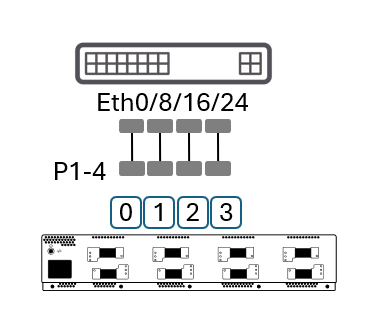
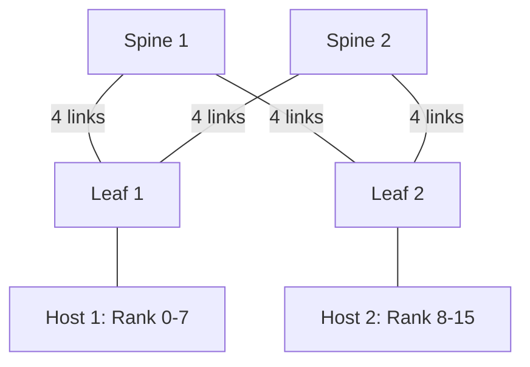

# SONiC RoCEv2 Test Plan

### Authors: Kamal Sahu (Keysight Technologies), Eric Yu (Keysight Technologies) and Vineet Mittal (Microsoft)

## Test Topology 1 – Functional test with single DUT

- Basic single-DUT functional topology.
- Tester connects four ports(rank 0,1,2,3) to the DUT at a common Ethernet speed (for example 800GE, 400GE, 200GE, or 100GE).
- Used for RoCEv2 functional and congestion-control scenarios.

<p float="left">
  
</p>

## Test Topology 2 – Functional and performance test with Clos fabric

- Two leaf switches and one spine switch forming a two-tier leaf/spine Clos fabric.
- Downlink and uplink use the same link speed.
- Used for test cases that require multiple DUTs, such as hashing and load balancing.

<p float="left">
  
</p>

## Test Topology 3 – Collective benchmark with 2x2 Clos fabric

- Two leaf switches and two spine switches forming a two-tier 2x2 Clos fabric. Every leaf connects to every spine.
- Each leaf has 8 uplinks (4 links to each spine), matching its 8 tester-facing ports (1:1, non-blocking). There are 16 leaf–spine links in total.
- All leaf–spine links use the same link speed as the tester-facing ports.
- The tester emulates two hosts with 8 ranks each (16 tester ports in total). Host 1 (Rank 0–7) connects to Leaf 1 and Host 2 (Rank 8–15) connects to Leaf 2.
- Used for the collective benchmark test cases that need multiple equal-cost paths, such as load balancing and link failover.



## Port Placement for T2 (Multi-ASIC / Multi-Linecard) Chassis

A T2 DUT is a single logical switch built from multiple linecards, each carrying one or more
forwarding ASICs, interconnected internally by fabric cards/fabric ASICs. Two ports that are
both "on the DUT" can therefore take very different internal datapaths depending on where they
sit, so a single run of Topology 1 or Topology 2 with an arbitrary 4-port selection does not
exercise a T2 platform representatively. Every test case in this plan that lists **T2** as an
applicable role must additionally be run once per placement variant below, selecting the rank
ports (Topology 1) or leaf-facing ports (Topology 2) accordingly.

| Variant | Description | Internal datapath exercised |
|---|---|---|
| **V1 – Intra-ASIC** | All test ports terminate on the same forwarding ASIC. | Local switching only; no fabric traversal. Baseline, comparable to a T0/T1 (pizzabox) result. |
| **V2 – Inter-ASIC, same linecard** | Test ports span two (or more) forwarding ASICs that sit on the same linecard. | Local/on-linecard ASIC-to-ASIC interconnect, if present, without crossing to a fabric card. |
| **V3 – Inter-linecard (cross-fabric)** | Test ports span forwarding ASICs on two different linecards. | Full fabric path: ingress ASIC → fabric card(s)/fabric ASIC → egress ASIC. This is the worst-case, most representative path for a disaggregated chassis and shall be treated as the mandatory minimum variant when time does not permit all three. |

<div align="center">

```
+-------------------- T2 Chassis --------------------+
|       Linecard 1                 Linecard 2        |
|       +---------+                +---------+       |
|       | ASIC 1a |                | ASIC 2a |       |
|       |  P1  P2 |                |  P5  P6 |       |
|       +----+----+                +----+----+       |
|            |                          |            |
|       +----+----+                +----+----+       |
|       | ASIC 1b |                | ASIC 2b |       |
|       |  P3  P4 |                |  P7  P8 |       |
|       +----+----+                +----+----+       |
|            |                          |            |
|            +------------+-------------+            |
|                         |                          |
|                  +-------------+                   |
|                  | Fabric Card |                   |
|                  |(fabric ASIC)|                   |
|                  +-------------+                   |
+----------------------------------------------------+

V1: P1 <-> P2   (same ASIC, ASIC 1a)
V2: P1 <-> P3   (same linecard, ASIC 1a <-> ASIC 1b, via local interconnect)
V3: P1 <-> P5   (different linecard, ASIC 1a -> Fabric Card -> ASIC 2a)
```

</div>

### Applying this to Topology 1 (single-DUT, 4-port) test cases

- Assign the four rank ports (rank 0–3) to satisfy the variant under test, e.g. for **V3**, put
  ranks 0/1 on Linecard 1 and ranks 2/3 on Linecard 2 so every flow crosses the fabric.
- Record which linecard and ASIC (e.g. via `show platform summary` and the DUT's port-to-ASIC
  mapping) each rank port belongs to in the run record, alongside the usual results.

### Applying this to Topology 2 (leaf/spine Clos) test cases

- When either leaf, or the spine, is itself a T2 chassis, additionally vary which linecard/ASIC
  the leaf-facing test ports and the leaf-to-spine uplinks land on, per the table above, instead
  of only exercising the external leaf/spine relationship.

---

## Test Case 1 – Basic dataplane traffic testing without congestion

### Objective

- Validate basic functionality for RoCEv2/RDMA AI traffic using:
  - Priority Flow Control (PFC)
  - ECN marking on the switch
  - CNP/ACK behavior on the endpoints
- Applicable roles: T0, T1, T2.
- **T2 chassis:** repeat with rank ports placed per each variant (V1/V2/V3) in
  [Port Placement for T2](#port-placement-for-t2-multi-asic--multi-linecard-chassis); V3
  (inter-linecard) is mandatory at minimum.

### Topology

- Uses Test Topology 1 (single DUT with four connected test ports).

<p float="left">
  
</p>

### Test Steps

### Prerequisites

1. Configure the DUT with both **lossless** and **lossy** queues.
   - Enable **PFC** on the lossless queues.
   - Configure **WRED with ECN marking** on the lossless queues.
   - Assume the following queue assignments:
     - **Queues 3 and 4:** Lossless queues
     - **Queues 0, 1, 2, 5, and 6:** Lossy queues
     - **Queue 5:** Reserved for **CNP (Congestion Notification Packet)** traffic
     - **Queue 6:** Reserved for **ACK/NAK (Acknowledgement/Negative Acknowledgement)** traffic
2. Determine the DSCP values for each queue from the DUT's `DSCP_TO_TC_MAP`.
   - If multiple DSCP values are mapped to the same traffic class (TC) or queue, randomly select one DSCP value for the test.

### Traffic Configuration

3. Configure two 1:1 traffic flows with one rank (endpoint) per port:
   - **Rank 0 → Rank 2:** Port1 → Port3
   - **Rank 1 → Rank 3:** Port2 → Port4

4. Configure constant-rate RoCEv2 AI traffic as follows:
   - **Lossless traffic (Rank 0 → Rank 2):**
     - Select a random DSCP value mapped to either **Queue 3** or **Queue 4**.
     - Configure **one Queue Pair (QP)** for the rank pair.
   - **Lossy traffic (Rank 1 → Rank 3):**
     - Configure one QP for each lossy priority (**Queues 0, 1, 2, 5, and 6**), resulting in **n** QPs per rank pair, where **n** is the number of lossy priorities under test.
     - The DSCP value mapped to **Queue 5** shall carry **CNP traffic**.
     - The DSCP value mapped to **Queue 6** shall carry **ACK/NAK traffic**.
5. Configure the following traffic parameters:
   - **Payload size:** 4 KB (or 8 KB if supported by the tester and the DUT)
   - **Message size:** 1 MB (256 packets per message burst at 4 KB payload size)
   - **Initial ECN field:** `00` (Not ECN-Capable)

6. Run lossless and lossy traffic for 3 minutes and verify the statistics.

### Expected Results

1. Verify the following:
   - Lossless and lossy traffic are forwarded successfully without packet loss.
   - No packet loss is observed on the traffic generator (tester).
   - No NAK packets or sequence errors are observed on the tester.
   - No ECN-CE packets, CNP transmissions, or CNP receptions are observed on the tester.
   - No PFC frames are generated on **Queue 3**/**queue 4**. The DUT PFC counters shall match the tester PFC counters.
   - ACK packets are observed on **Queue 6**. The DUT ACK counters shall match the tester ACK counters.
   - No ECN-CE marking is observed on **Queue 3** or **Queue 4**. The DUT ECN-CE counters shall match the tester ECN-CE counters.
   - No CNP packets are observed on **Queue 5**. The DUT CNP counters shall match the tester CNP counters.
   - Record the average and maximum packet latency. Both values shall be within the DUT specification.
2.	A successful test indicates that the DUT correctly forwards RoCEv2 AI data traffic and associated control traffic under congestion-free conditions without packet loss, congestion notification, or flow-control events.

## Test Case 2 – Congestion Control with PFC for AI Traffic

### Objective

- Validate basic congestion control for RoCEv2/RDMA AI traffic using:
  - Priority Flow Control (PFC)
  - ECN marking on the switch
  - CNP/ACK behavior on the endpoints
- Applicable roles: T0, T1, T2.
- **T2 chassis:** repeat with rank ports placed per each variant (V1/V2/V3) in
  [Port Placement for T2](#port-placement-for-t2-multi-asic--multi-linecard-chassis); V3
  (inter-linecard) is mandatory at minimum.

### Topology

- Uses Test Topology 1 (single DUT with four connected test ports).

<p float="left">
  
</p>

### Test Steps

### Prerequisites

1. Configure the DUT with the following queue assignments:
   - **Queue 3:** Lossless queue
   - **Queue 4:** Lossless queue
   - **Queue 0, 1, 2** Lossy queues
   - **Queue 5:** Reserved for **CNP (Congestion Notification Packet)** traffic
   - **Queue 6:** Reserved for **ACK(Acknowledgement)/NAK(Negative Acknowledgement)** traffic
   - Enable **PFC** and **ECN marking** on the lossless queues.

2. Determine the DSCP values corresponding to **Queue 0**, **Queue 1**, **Queue 2**, **Queue 3**, **Queue 4**, **Queue 5** and **Queue 6** from the DUT's `DSCP_TO_TC_MAP`.
   - If multiple DSCP values are mapped to a queue, randomly select one DSCP value for the test.

3. Configure a **3:1 incast** topology with one rank (endpoint) per port:
   - **Rank 0 → Rank 3**
   - **Rank 1 → Rank 3**
   - **Rank 2 → Rank 3**

### Test Scenario 1 – Single Lossless and Lossy Incast

4. Configure stateful RoCEv2 traffic with the following parameters:
   - Configure **one Queue Pair (QP)** per rank pair.
   - Each rank pair shall transmit **4 GB** of data traffic.
   - **Rank 0 → Rank 3**
     - Data traffic shall use the **DSCP value mapped to Queue 3** (lossless).
   - **Rank 1 → Rank 3**
     - Data traffic shall use the **DSCP value mapped to Queue 3** (lossless).
   - **Rank 2 → Rank 3**
     - Configure one QP for each lossy queue (**Queues 0, 1, and 2**).
     - Data traffic shall use the **DSCP values mapped to Queues 0, 1, and 2**, respectively.
   - CNP traffic shall use the **DSCP value mapped to Queue 5**.
   - ACK/NAK traffic shall use the **DSCP value mapped to Queue 6**.
   - **Payload size:** 4 KB (or 8 KB if supported by the tester and the DUT)
   - **Message size:** 128 KB (32 packets per message burst at 4 KB payload size)
   - **Traffic rate:** 100% line rate per transmitting port
   - **Initial ECN field:** `00` (Not ECN-Capable)

5. Run the traffic until completion and validate the traffic and DUT statistics.

### Test Scenario 2 – Dual Lossless and Lossy Incast

6. Configure stateful RoCEv2 traffic with the following parameters:
   - Configure **one Queue Pair (QP)** per lossless rank pair.
   - Configure **one Queue Pair (QP)** for each lossy queue on the lossy rank pair.
   - Each rank pair shall transmit **4 GB** of data traffic.
   - **Rank 0 → Rank 3**
     - Data traffic shall use the **DSCP value mapped to Queue 3** (lossless).
   - **Rank 1 → Rank 3**
     - Data traffic shall use the **DSCP value mapped to Queue 4** (lossless).
   - **Rank 2 → Rank 3**
     - Configure one QP for each lossy queue (**Queues 0, 1, and 2**).
     - Data traffic shall use the **DSCP values mapped to Queues 0, 1, and 2**, respectively.
   - CNP traffic shall use the **DSCP value mapped to Queue 5**.
   - ACK/NAK traffic shall use the **DSCP value mapped to Queue 6**.
   - **Payload size:** 4 KB (or 8 KB if supported by the tester and the DUT)
   - **Message size:** 128 KB (32 packets per message burst at 4 KB payload size)
   - **Traffic rate:** 100% line rate per transmitting port
   - **Initial ECN field:** `00` (Not ECN-Capable)

7. Run the traffic until completion and validate the traffic and DUT statistics.

### Test Scenario 3 – Mixed Message Sizes with Lossless and Lossy Incast

8. Configure stateful RoCEv2 traffic with the following parameters:
   - Configure **one Queue Pair (QP)** per lossless rank pair.
   - Configure **one Queue Pair (QP)** for each lossy queue on the lossy rank pair.
   - Each rank pair shall transmit **4 GB** of data traffic.
   - **Rank 0 → Rank 3**
     - Data traffic shall use the **DSCP value mapped to Queue 3** (lossless).
     - **Payload size:** 4 KB (or 8 KB if supported by the tester and the DUT)
     - **Message size:** 128 KB (32 packets per message burst at 4 KB payload size)
   - **Rank 1 → Rank 3**
     - Data traffic shall use the **DSCP value mapped to Queue 4** (lossless).
     - **Payload size:** 4 KB (or 8 KB if supported by the tester and the DUT)
     - **Message size:** 4 KB (**WRITE-only** message)
   - **Rank 2 → Rank 3**
     - Configure one QP for each lossy queue (**Queues 0, 1, and 2**).
     - Data traffic shall use the **DSCP values mapped to Queues 0, 1, and 2**, respectively.
     - **Payload size:** 4 KB (or 8 KB if supported by the tester and the DUT)
     - **Message size:** 128 KB (32 packets per message burst at 4 KB payload size)
   - CNP traffic shall use the **DSCP value mapped to Queue 5**.
   - ACK/NAK traffic shall use the **DSCP value mapped to Queue 6**.
   - **Traffic rate:** 100% line rate per transmitting port
   - **Initial ECN field:** `00` (Not ECN-Capable)

9. Run the traffic until completion and validate the traffic and DUT statistics.

### Expected Results

### 1. Test Scenario 1 (Step 5)

All messages shall complete successfully.

- No packet loss shall be observed on the tester.
- No NAK packets or sequence errors shall be observed on the tester.
- No ECN-CE marking or CNP Tx/Rx shall be observed on the tester.
- PFC frames shall be observed on **Queue 3**, and the DUT PFC counters shall match the tester PFC counters.
- ACK packets shall be observed on **Queue 6**, and the DUT ACK counters shall match the tester ACK counters.
- No ECN-CE packets shall be observed on **Queue 3**, and the DUT ECN-CE counters shall match the tester ECN-CE counters.
- No CNP packets shall be observed on **Queue 5**, and the DUT CNP counters shall match the tester CNP counters.
- Record the average and maximum latency. Both values shall be within the DUT specification.

### 2. Test Scenarios 2 and 3 (Steps 7 and 9)

All messages shall complete successfully.

- No packet loss shall be observed on the tester.
- No NAK packets or sequence errors shall be observed on the tester.
- No ECN-CE marking or CNP Tx/Rx shall be observed on the tester.
- PFC frames shall be observed on **Queue 3** for **Rank 0**, and the DUT PFC counters shall match the tester PFC counters.
- PFC frames shall be observed on **Queue 4** for **Rank 1**, and the DUT PFC counters shall match the tester PFC counters.
- ACK packets shall be observed on **Queue 6**, and the DUT ACK counters shall match the tester ACK counters.
- No ECN-CE packets shall be observed on **Queue 3** or **Queue 4**, and the DUT ECN-CE counters shall match the tester ECN-CE counters.
- No CNP packets shall be observed on **Queue 5**, and the DUT CNP counters shall match the tester CNP counters.
- Record the average and maximum latency. Both values shall be within the DUT specification.

## Test Case 3 – Congestion Control with DCQCN for AI Traffic

### Objective

- Validate basic congestion control for RoCEv2/RDMA AI traffic using:
  - Priority Flow Control (PFC)
  - ECN marking on the switch
  - CNP/ACK behavior on the endpoints
- Applicable roles: T0, T1, T2.
- **T2 chassis:** repeat with rank ports placed per each variant (V1/V2/V3) in
  [Port Placement for T2](#port-placement-for-t2-multi-asic--multi-linecard-chassis); V3
  (inter-linecard) is mandatory at minimum.

### Topology

- Uses Test Topology 1 (single DUT with four connected test ports).

<p float="left">
  
</p>

### Prerequisites

1. Configure the DUT with the following queue assignments:
   - **Queue 3:** Lossless queue
   - **Queue 4:** Lossless queue
   - **Queue 0, 1, 2** Lossy queues
   - **Queue 5:** Reserved for **CNP (Congestion Notification Packet)** traffic
   - **Queue 6:** Reserved for **ACK(Acknowledgement)/NAK(Negative Acknowledgement)** traffic
   - Enable **PFC** and **ECN marking** on the lossless queues.

2. Determine the DSCP values corresponding to **Queue 0**, **Queue 1**, **Queue 2**, **Queue 3**, **Queue 4**, **Queue 5** and **Queue 6** from the DUT's `DSCP_TO_TC_MAP`.
   - If multiple DSCP values are mapped to a queue, randomly select one DSCP value for the test.

3. Configure a **3:1 incast** topology with one rank (endpoint) per port:
   - **Rank 0 → Rank 3**
   - **Rank 1 → Rank 3**
   - **Rank 2 → Rank 3**

### Test Steps

### Test Scenario 1 – Single Lossless and Lossy Incast with DCQCN

4. Configure stateful RoCEv2 traffic with the following parameters:
   - Configure **one Queue Pair (QP)** per rank pair.
   - Each rank pair shall transmit **4 GB** of data traffic.
   - **Rank 0 → Rank 3**
     - Data traffic shall use the **DSCP value mapped to Queue 3** (lossless).
   - **Rank 1 → Rank 3**
     - Data traffic shall use the **DSCP value mapped to Queue 3** (lossless).
   - **Rank 2 → Rank 3**
     - Configure one QP for each lossy queue (**Queues 0, 1, and 2**).
     - Data traffic shall use the **DSCP values mapped to Queues 0, 1, and 2**, respectively.
   - CNP traffic shall use the **DSCP value mapped to Queue 5**.
   - ACK/NAK traffic shall use the **DSCP value mapped to Queue 6**.
   - **Payload size:** 4 KB (or 8 KB if supported by the tester and the DUT)
   - **Message size:** 128 KB (32 packets per message burst at 4 KB payload size)
   - **Traffic rate:** 100% line rate per transmitting port
   - **Initial ECN field:** `01/10` (ECN-Capable)
5. Run traffic and validate statistics.

### Test Scenario 2 – Dual Lossless and Lossy Incast with DCQCN.

6. Configure stateful RoCEv2 traffic with the following parameters:
   - Configure **one Queue Pair (QP)** per lossless rank pair.
   - Configure **one Queue Pair (QP)** for each lossy queue on the lossy rank pair.
   - Each rank pair shall transmit **4 GB** of data traffic.
   - **Rank 0 → Rank 3**
     - Data traffic shall use the **DSCP value mapped to Queue 3** (lossless).
   - **Rank 1 → Rank 3**
     - Data traffic shall use the **DSCP value mapped to Queue 4** (lossless).
   - **Rank 2 → Rank 3**
     - Configure one QP for each lossy queue (**Queues 0, 1, and 2**).
     - Data traffic shall use the **DSCP values mapped to Queues 0, 1, and 2**, respectively.
   - CNP traffic shall use the **DSCP value mapped to Queue 5**.
   - ACK/NAK traffic shall use the **DSCP value mapped to Queue 6**.
   - **Payload size:** 4 KB (or 8 KB if supported by the tester and the DUT)
   - **Message size:** 128 KB (32 packets per message burst at 4 KB payload size)
   - **Traffic rate:** 100% line rate per transmitting port
   - **Initial ECN field:** `01/10` (ECN-Capable)
7. Run traffic and validate statistics.
8. Set ECN-CE bit value 11
9. Run traffic and validate statistics.
10. Increase endpoint per port to 4K for testing T2, distributing the 4K endpoints across
    linecards/ASICs per the V1/V2/V3 variants in
    [Port Placement for T2](#port-placement-for-t2-multi-asic--multi-linecard-chassis)

### Expected Results

1. In step 5, all messages should be completed successfully.

- No loss should be observed on the tester.
- No NAK and sequence error on the tester.
- Few or no PFC should be observed on queue 3, matching tester PFC counter.
- ACK should be observed on queue 6, matching tester ACK counter.
- ECN-CE should be observed on queue 3, matching tester ECN-CE counter.
- CNP should be observed on queue 5, matching tester CNP counter.
- Note Avg/Max latency and it should be within DUT spec.

2. In step 7, all messages should be completed successfully.

- No loss should be observed on the tester.
- No NAK and sequence error on the tester.
- Few or no PFC should be observed on queue 3, matching tester PFC counter for rank0.
- Few or no PFC should be observed on queue 4, matching tester PFC counter for rank1.
- ACK should be observed on queue 6, matching tester ACK counter for rank0.
- ACK should be observed on queue 6, matching tester ACK counter for rank1.
- ECN-CE should be observed on queue 3, matching tester ECN-CE counter for rank0.
- ECN-CE should be observed on queue 4, matching tester ECN-CE counter for rank1.
- CNP should be observed on queue 5, matching tester CNP counter.
- Note Avg/Max latency and it should be within DUT spec.

3. In step 9, all messages should be completed successfully.

- No loss should be observed on the tester.
- No NAK and sequence error on the tester.
- Few or no PFC should be observed on queue 3, matching tester PFC counter for rank0.
- Few or no PFC should be observed on queue 4, matching tester PFC counter for rank1.
- ACK should be observed on queue 6, matching tester ACK counter for rank0.
- ACK should be observed on queue 6, matching tester ACK counter for rank1.
- All data packets marked with ECN-CE should be observed on queue 3 or 4, matching tester ECN-CE counter.
- CNP should be observed on queue 5, matching tester CNP counter.
- Note Avg/Max latency and it should be within DUT spec.

4. Successful test results indicate that DUT forward RoCEv2 AI traffic and control signaling as expected. DCQCN congestion control functions as expected.


## Test Case 4 – Congestion Control with PFC and ECN/CNP for Storage Traffic

### Objective

- Validate basic congestion control for RoCEv2/RDMA storage traffic using PFC and ECN/CNP.
- Applicable roles: T0, T1, T2.
- **T2 chassis:** repeat with rank ports placed per each variant (V1/V2/V3) in
  [Port Placement for T2](#port-placement-for-t2-multi-asic--multi-linecard-chassis); V3
  (inter-linecard) is mandatory at minimum.

### Topology

- Uses Test Topology 1.

<p float="left">
  
</p>

### Prerequisites

1. Configure the DUT with the following queue assignments:
   - **Queue 3:** Lossless queue
   - **Queue 4:** Lossless queue
   - **Queue 0, 1, 2** Lossy queues
   - **Queue 5:** Reserved for **CNP (Congestion Notification Packet)** traffic
   - **Queue 6:** Reserved for **ACK(Acknowledgement)/NAK(Negative Acknowledgement)** traffic
   - Enable **PFC** and **ECN marking** on the lossless queues.

2. Determine the DSCP values corresponding to **Queue 0**, **Queue 1**, **Queue 2**, **Queue 3**, **Queue 4**, **Queue 5** and **Queue 6** from the DUT's `DSCP_TO_TC_MAP`.
   - If multiple DSCP values are mapped to a queue, randomly select one DSCP value for the test.

3. Configure a **3:1 incast** topology with one rank (endpoint) per port:
   - **Rank 0 → Rank 3**
   - **Rank 1 → Rank 3**
   - **Rank 2 → Rank 3**

### Test Steps

### Test Scenario 1 – Single Lossless and Lossy Incast with/without DCQCN

4. Configure stateful RoCEv2 traffic with the following parameters:
   - Configure **one Queue Pair (QP)** per rank pair.
   - Each rank pair shall transmit **4 GB** of data traffic.
   - **Rank 0 → Rank 3**
     - Data traffic shall use the **DSCP value mapped to Queue 3** (lossless).
   - **Rank 1 → Rank 3**
     - Data traffic shall use the **DSCP value mapped to Queue 3** (lossless).
   - **Rank 2 → Rank 3**
     - Configure one QP for each lossy queue (**Queues 0, 1, and 2**).
     - Data traffic shall use the **DSCP values mapped to Queues 0, 1, and 2**, respectively.
   - CNP traffic shall use the **DSCP value mapped to Queue 5**.
   - ACK/NAK traffic shall use the **DSCP value mapped to Queue 6**.
   - **Payload size:** 4 KB (or 8 KB if supported by the tester and the DUT)
   - **Message size:** 1 MB (256 packets per message burst at 4 KB payload size)
   - **Traffic rate:** 100% line rate per transmitting port
   - **Initial ECN field:** `01/10` (ECN-Capable)
   - **Configure constant rate traffic (RoCEv2 storage traffic)**
   - Disable **DCQCN**
5. Run traffic for 3 minutes and validate statistics.
6. Enable **DCQCN**
7. Run traffic for 3 minutes and validate statistics.

### Test Scenario 2 – Dual Lossless and Lossy Incast with/without DCQCN.

8. Configure stateful RoCEv2 traffic with the following parameters:
   - Configure **one Queue Pair (QP)** per lossless rank pair.
   - Configure **one Queue Pair (QP)** for each lossy queue on the lossy rank pair.
   - Each rank pair shall transmit **4 GB** of data traffic.
   - **Rank 0 → Rank 3**
     - Data traffic shall use the **DSCP value mapped to Queue 3** (lossless).
   - **Rank 1 → Rank 3**
     - Data traffic shall use the **DSCP value mapped to Queue 4** (lossless).
   - **Rank 2 → Rank 3**
     - Configure one QP for each lossy queue (**Queues 0, 1, and 2**).
     - Data traffic shall use the **DSCP values mapped to Queues 0, 1, and 2**, respectively.
   - CNP traffic shall use the **DSCP value mapped to Queue 5**.
   - ACK/NAK traffic shall use the **DSCP value mapped to Queue 6**.
   - **Payload size:** 4 KB (or 8 KB if supported by the tester and the DUT)
   - **Message size:** 1 MB (256 packets per message burst at 4 KB payload size)
   - **Traffic rate:** 100% line rate per transmitting port
   - **Initial ECN field:** `01/10` (ECN-Capable)
   - **Configure constant rate traffic (RoCEv2 storage traffic)**
   - Disable **DCQCN**
9. Run traffic for 3 minutes and validate statistics.
10. Enable **DCQCN**
11. Run traffic for 3 minutes and validate statistics.
12. Increase endpoint per port to 4K for testing T2, distributing the 4K endpoints across
    linecards/ASICs per the V1/V2/V3 variants in
    [Port Placement for T2](#port-placement-for-t2-multi-asic--multi-linecard-chassis)

### Expected Results

1. In step 5 & 7, all messages should be completed successfully.

- No loss should be observed on the tester.
- No NAK and sequence error on the tester.
- PFC should be observed on queue 3, matching tester PFC counter.
- ACK should be observed on queue 6, matching tester ACK counter.
- ECN-CE should be observed on queue 3, matching tester ECN-CE counter.
- CNP should be observed on queue 5, matching tester CNP counter.
- Note Bandwidth during traffic run and it should be within DUT spec.
- Note Avg/Max latency and it should be within DUT spec.

2. In step 7, no or few PFC should be observed on queue 3 .

3. In step 9, all messages should be completed successfully.
- No loss should be observed on the tester.
- No NAK and sequence error on the tester.
- PFC should be observed on queue 3, matching tester PFC counter for rank0.
- PFC should be observed on queue 4, matching tester PFC counter for rank1.
- ACK should be observed on queue 3, matching tester ACK counter for rank0.
- ACK should be observed on queue 4, matching tester ACK counter for rank1.
- ECN-CE should be observed on queue 3, matching tester ECN-CE counter for rank0.
- ECN-CE should be observed on queue 4, matching tester ECN-CE counter for rank1.
- CNP should be observed on queue 6, matching tester CNP counter.
- Note Bandwidth during traffic run and it should be within DUT spec.
- Note Avg/Max latency and it should be within DUT spec.

4. In step 11, no or few PFC should be observed on queue 3 and queue 4.

5. Successful test result indicates that DUT forward RoCEv2 storage traffic and control signaling as expected. PFC and ECN/CNP congestion signaling and congestion control function as expected.

 ## Test Case 5 – PFC propagation

### Objective

- Validate basic PFC propagation for RoCEv2/RDMA AI/storage traffic.
- Applicable roles: T0, T1, T2.
- **T2 chassis:** repeat with rank ports placed per each variant (V1/V2/V3) in
  [Port Placement for T2](#port-placement-for-t2-multi-asic--multi-linecard-chassis); V3
  (inter-linecard) is mandatory at minimum.

### Topology

- Uses Test Topology 1.

<p float="left">
  
</p>

### Prerequisites

1. Configure the DUT with both **lossless** and **lossy** queues.
   - Enable **PFC** on the lossless queues.
   - Configure **WRED with ECN marking** on the lossless queues.
   - Assume the following queue assignments:
     - **Queues 3 and 4:** Lossless queues
     - **Queues 0, 1, 2, 5, and 6:** Lossy queues
     - **Queue 5:** Reserved for **CNP (Congestion Notification Packet)** traffic
     - **Queue 6:** Reserved for **ACK/NAK (Acknowledgement/Negative Acknowledgement)** traffic
2. Determine the DSCP values for each queue from the DUT's `DSCP_TO_TC_MAP`.
   - If multiple DSCP values are mapped to the same traffic class (TC) or queue, randomly select one DSCP value for the test.

### Test Steps

3. Configure two 1:1 traffic flows with one rank (endpoint) per port:
   - **Rank 0 → Rank 2:** Port1 → Port3
   - **Rank 1 → Rank 3:** Port2 → Port4

4. Configure constant-rate RoCEv2 AI traffic as follows:
   - **Lossless traffic (Rank 0 → Rank 2):**
     - Select a random DSCP value mapped to either **Queue 3** or **Queue 4**.
     - Configure **one Queue Pair (QP)** for the rank pair.
   - **Lossy traffic (Rank 1 → Rank 3):**
     - Configure one QP for each lossy priority (**Queues 0, 1 and 2**).
     - The DSCP value mapped to **Queue 5** shall carry **CNP traffic**.
     - The DSCP value mapped to **Queue 6** shall carry **ACK/NAK traffic**.
     - **Payload size:** 4 KB (or 8 KB if supported by the tester and the DUT)
     - **Message size:** 128 KB (32 packets per message burst at 4 KB payload size)
     - **Traffic rate:** 100% line rate per transmitting port
     - **Initial ECN field:** `01/10` (ECN-Capable)
     - **Configure constant rate traffic (RoCEv2 storage traffic)**
     - Disable **DCQCN**
5. Run traffic for 30 seconds and validate statistics.
6. Configure PFC generation on rank2 and 3 for 90% available bandwidth.
7. Run traffic for 30 seconds and validate statistics.
8. Increase endpoint per port to 4K for testing T2, distributing the 4K endpoints across
   linecards/ASICs per the V1/V2/V3 variants in
   [Port Placement for T2](#port-placement-for-t2-multi-asic--multi-linecard-chassis)

### Expected Results

1. In step 5, all messages should be completed successfully.
- No loss should be observed on the tester.
- No NAK and sequence error on the tester.
- No PFC should be observed on queue 3, matching tester PFC counter.
- No PFC should be observed on queue 4, matching tester PFC counter.
2. In step 7, all messages should be completed successfully.
- No loss should be observed on the tester.
- No NAK and sequence error on the tester.
- PFC should be observed on queue 3, matching tester PFC counter.
- PFC should be observed on queue 4, matching tester PFC counter.
3. Successful test results indicate that DUT forward RoCEv2 AI traffic and PFC generated by tester as expected.


## Test Case 6 – QP Fairness with DCQCN

### Objective

- Validate fairness between QPs under congestion controlled with DCQCN.
- **T2 chassis:** repeat with the 3:1 incast rank ports placed per each variant (V1/V2/V3) in
  [Port Placement for T2](#port-placement-for-t2-multi-asic--multi-linecard-chassis) — fairness
  is most at risk in V3, where flows converge on a shared egress ASIC only after traversing
  different fabric paths.

### Topology

- Can use Test Topology 1 or 2; single-DUT topology is sufficient for illustration.

<p float="left">
  
</p>

### Prerequisites

1. Configure the DUT with the following queue assignments:
   - **Queue 3:** Lossless queue
   - **Queue 4:** Lossless queue
   - **Queue 0, 1, 2** Lossy queues
   - **Queue 5:** Reserved for **CNP (Congestion Notification Packet)** traffic
   - **Queue 6:** Reserved for **ACK(Acknowledgement)/NAK(Negative Acknowledgement)** traffic
   - Enable **PFC** and **ECN marking** on the lossless queues.

2. Determine the DSCP values corresponding to **Queue 0**, **Queue 1**, **Queue 2**, **Queue 3**, **Queue 4**, **Queue 5** and **Queue 6** from the DUT's `DSCP_TO_TC_MAP`.
   - If multiple DSCP values are mapped to a queue, randomly select one DSCP value for the test.

3. Configure a **3:1 incast** topology with one rank (endpoint) per port:
   - **Rank 0 → Rank 3**
   - **Rank 1 → Rank 3**
   - **Rank 2 → Rank 3**

### Test Steps

### Test Scenario 1 – Single Lossless and Lossy Incast with DCQCN

4. Configure stateful RoCEv2 traffic with the following parameters:
   - Configure **one Queue Pair (QP)** per rank pair.
   - Each rank pair shall transmit **4 GB** of data traffic.
   - **Rank 0 → Rank 3**
     - Data traffic shall use the **DSCP value mapped to Queue 3** (lossless).
   - **Rank 1 → Rank 3**
     - Data traffic shall use the **DSCP value mapped to Queue 3** (lossless).
   - **Rank 2 → Rank 3**
     - Configure one QP for each lossy queue (**Queues 0, 1, and 2**).
     - Data traffic shall use the **DSCP values mapped to Queues 0, 1, and 2**, respectively.
   - CNP traffic shall use the **DSCP value mapped to Queue 5**.
   - ACK/NAK traffic shall use the **DSCP value mapped to Queue 6**.
   - **Payload size:** 4 KB (or 8 KB if supported by the tester and the DUT)
   - **Message size:** 1 MB (256 packets per message burst at 4 KB payload size)
   - **Traffic rate:** 100% line rate per transmitting port
   - **Initial ECN field:** `01/10` (ECN-Capable)

5. Run traffic for 3 minutes and validate statistics.

### Test Scenario 2 – Dual Lossless and Lossy Incast with DCQCN

6. Configure stateful RoCEv2 traffic with the following parameters:
   - Configure **one Queue Pair (QP)** per lossless rank pair.
   - Configure **one Queue Pair (QP)** for each lossy queue on the lossy rank pair.
   - Each rank pair shall transmit **4 GB** of data traffic.
   - **Rank 0 → Rank 3**
     - Data traffic shall use the **DSCP value mapped to Queue 3** (lossless).
   - **Rank 1 → Rank 3**
     - Data traffic shall use the **DSCP value mapped to Queue 4** (lossless).
   - **Rank 2 → Rank 3**
     - Configure one QP for each lossy queue (**Queues 0, 1, and 2**).
     - Data traffic shall use the **DSCP values mapped to Queues 0, 1, and 2**, respectively.
   - CNP traffic shall use the **DSCP value mapped to Queue 5**.
   - ACK/NAK traffic shall use the **DSCP value mapped to Queue 6**.
   - **Payload size:** 4 KB (or 8 KB if supported by the tester and the DUT)
   - **Message size:** 1 MB (256 packets per message burst at 4 KB payload size)
   - **Traffic rate:** 100% line rate per transmitting port
   - **Initial ECN field:** `01/10` (ECN-Capable)

7. Run traffic for 3 minutes and validate statistics.
8. Configure n:1 in-cast test traffic to check QP fairness further.

### Expected Result:

1. In step 5, all messages should be completed successfully.
- No loss should be observed on the tester.
- No NAK and sequence error on the tester.
- Few or no PFC should be observed on queue 3, matching tester PFC counter.
- ACK should be observed on queue 6, matching tester ACK counter.
- ECN-CE should be observed on queue 3, matching tester ECN-CE counter.
- CNP should be observed on queue 5, matching tester CNP counter.
- Note Bandwidth during traffic run and Tx Rate of rank0 and rank1 should be fair, with a deviation less than 30%.

2. In step 7, all messages should be completed successfully.
- No loss should be observed on the tester.
- No NAK and sequence error on the tester.
- Few or no PFC should be observed on queue 3, matching tester PFC counter for rank0.
- Few or no PFC should be observed on queue 4, matching tester PFC counter for rank1.
- ACK should be observed on queue 6, matching tester ACK counter for rank0.
- ACK should be observed on queue 6, matching tester ACK counter for rank1.
- ECN-CE should be observed on queue 3, matching tester ECN-CE counter for rank0.
- ECN-CE should be observed on queue 4, matching tester ECN-CE counter for rank1.
- CNP should be observed on queue 5, matching tester CNP counter.
- Note Bandwidth during traffic run and Tx Rate of rank0 and rank1 should be fair, with a deviation less than 30%.

## Test Case 7 – Hashing and Load Balancing

### Objective

- Validate the DUT’s load-balancing and hashing behavior for distributing RoCEv2 traffic across multiple upstream links.
- Focus on avoiding congestion while preserving flow ordering.
- Applies to T0 and T1 uplinks. For **T2**, hashing is also exercised **internally** between
  linecard ASICs and fabric cards, and this is not optional: whenever a rank pair's egress ASIC
  differs from its ingress ASIC (variants V2/V3), the DUT must hash across the available
  ASIC-to-fabric or fabric-to-ASIC links exactly as it would across external uplinks.

### Topology

- Uses Test Topology 2 (leaf–spine Clos) for the external-uplink scenarios.
- For T2, additionally repeat the steps below using Test Topology 1 with rank ports placed to
  force variant **V3** (inter-linecard) from
  [Port Placement for T2](#port-placement-for-t2-multi-asic--multi-linecard-chassis), so that
  "Leaf 1 egress statistics" below is read as the egress-linecard/ASIC fabric-facing statistics
  rather than an external leaf uplink.

<p float="left">
  
</p>

### Prerequisites

1. Configure the DUT with the following queue assignments:
   - **Queue 3:** Lossless queue.
   - Enable **PFC** and **ECN marking** on the lossless queue.

2. Determine the DSCP value corresponding to **Queue 3** from the DUT's `DSCP_TO_TC_MAP`.
   - If multiple DSCP values are mapped to the queue, randomly select one DSCP value for the test.

3. Configure continuous stateful RoCEv2 traffic with the following parameters:
   - **Payload size:** 4 KB (or 8 KB if supported by the tester and the DUT)
   - **Message size:** 1 MB
   - Data traffic shall use the **DSCP value mapped to Queue 3**.
   - ACK/NAK traffic shall use the **DSCP value mapped to Queue 6**.
   - CNP traffic shall use the **DSCP value mapped to Queue 5**.
   - Traffic shall run continuously throughout each test scenario.

### Test Steps

1. Configure **one rank pair (Rank 0 → Rank 4)** with **1 QP** and verify **Leaf 1** egress statistics.
2. Increase to **X QPs** for the same rank pair and verify **Leaf 1** egress statistics.
3. Configure **two rank pairs (Rank 0 → Rank 4 and Rank 1 → Rank 5)** with **1 QP** per rank pair and verify **Leaf 1** egress statistics.
4. Enable **staggered transmit** on the tester and verify **Leaf 1** egress statistics.
5. Increase to **X QPs** per rank pair while staggered transmit is enabled and verify **Leaf 1** egress statistics.
6. Configure **four rank pairs (Rank 0 → Rank 4, Rank 1 → Rank 5, Rank 2 → Rank 6, Rank 3 → Rank 7)** with **1 QP** per rank pair and verify **Leaf 1** egress statistics.
7. Enable **staggered transmit** on the tester and verify **Leaf 1** egress statistics.
8. Increase to **X QPs** per rank pair while staggered transmit is enabled and verify **Leaf 1** egress statistics.


### Expected Results

1.	In step 1, expect traffic on 1 egress port, no congestion.
2.	In step 2, expect traffic on 1 or more egress port, no congestion.
3.	In step 3, expect traffic on 1 egress port, 2-1 incast congestion.
4.	In step 4, expect traffic on 2 egress ports, no congestion
5.	In step 5, expect traffic on 2 or more egress port, no congestion.
6.	In step 6, expect traffic on 1 egress ports, 4-1 incast congestion
7.	In step 7, expect traffic on 2 or more egress ports, no congestion.
8.	In step 8, expect traffic on 2 or more egress ports, no congestion

### Notes

1.	Hashing algorithm maybe different for different HW if different switch chip is used. The hashing algorithm is typically secret sauce of switch chip.
2.	Most of switch chip has dynamic hashing based on traffic load. In this case, the start time of various flows will impact hashing result.
3.	This kind of p2p test reflects pipeline parallelism and expert parallelism in real AI world training and inferencing. It is a good reference of hash behavior of DUT.
4.	On a T2 chassis the ingress ASIC, the fabric ASIC, and the egress ASIC may each hash
	independently. A flow that hashes evenly across fabric links from the ingress ASIC can still
	land unevenly at the egress ASIC (or vice versa) — verify egress statistics at both the
	fabric-facing and network-facing stages, not only at the final network egress port.

## Test Case 8 – Packet Spray

### Objective

- Validate load balancing using packet spray such that traffic is efficiently distributed across all available links, while maintaining acceptable out-of-order characteristics.

### Topology

- Uses Test Topology 2.

<p float="left">
  
</p>

### Prerequisites

1. Configure the DUT with the following queue assignments:
   - **Queue 3:** Lossless queue.
   - Enable **PFC** and **ECN marking** on the lossless queue.

2. Determine the DSCP value corresponding to **Queue 3** from the DUT's `DSCP_TO_TC_MAP`.
   - If multiple DSCP values are mapped to the queue, randomly select one DSCP value for the test.

3. Configure continuous stateful RoCEv2 traffic with the following parameters:
   - **Payload size:** 4 KB (or 8 KB if supported by the tester and the DUT)
   - **Message size:** 128 KB
   - Data traffic shall use the **DSCP value mapped to Queue 3**.
   - ACK/NAK traffic shall use the **DSCP value mapped to Queue 6**.
   - Configure one CNP queue using the **DSCP value mapped to the configured CNP queue**.
   - Traffic shall run continuously throughout each test scenario.

### Test Steps

1. Configure **4 GB all-to-all** stateful RoCEv2 traffic between **8 ranks**.
2. Configure the traffic with the following parameters:
   - Data traffic shall use the **DSCP value mapped to Queue 3**.
   - ACK/NAK traffic shall use the **DSCP value mapped to Queue 6**.
   - CNP traffic shall use the **DSCP value mapped to Queue 5**.
   - **Payload size:** 4 KB (or 8 KB if supported by the tester and the DUT)
   - **Message size:** 128 KB (32 packets per message burst at 4 KB payload size)
   - **Initial ECN field:** `ECT(0)` or `ECT(1)` (`10` or `01`).
3. Enable **Out-of-Order (OoO)** support on the tester.
4. Run the traffic until completion and validate the traffic and DUT statistics.

### Expected Results:

1. In Step 4, all messages shall complete successfully.

- No packet loss, NAK packets, or sequence errors shall be observed on the tester.
- No PFC frames shall be observed on **Queue 3**, and the DUT PFC counters shall match the tester PFC counters.
- ACK packets shall be observed on **Queue 6**, and the DUT ACK counters shall match the tester ACK counters.
- No ECN-CE marked packets shall be observed on **Queue 3**, and the DUT ECN-CE counters shall match the tester ECN-CE counters.
- No CNP packets shall be observed on **Queue 5**, and the DUT CNP counters shall match the tester CNP counters.
- Packet distribution across the DUT egress ports shall be balanced and match the expected all-to-all traffic pattern.
- Record the average and maximum latency. Both values shall be within the DUT specification.

2. Successful completion of the test indicates that the DUT correctly forwards all-to-all RoCEv2 traffic with Out-of-Order (OoO) support enabled while maintaining balanced egress traffic distribution and expected control-plane behavior.


## Test Case 9 – QoS Profile Prioritizing Lossless Traffic

### Objective

- Validate that the DUT prioritizes RoCEv2 lossless traffic and guarantees bandwidth in the presence of competing best-effort traffic.
- Particularly relevant for T2 with mixed lossless and lossy traffic.
- **T2 chassis:** additionally place the background flows (Port 0-2 → Port 4-6) and the RoCEv2
  rank pair (Rank 3 → Rank 7) so the contended egress is a shared **fabric** link (variant V3 in
  [Port Placement for T2](#port-placement-for-t2-multi-asic--multi-linecard-chassis)) — the
  scheduler that must prioritize lossless traffic sits on the fabric-facing egress of the
  ingress ASIC, not only on the network-facing egress of the leaf.

### Topology

- Uses Test Topology 2, with one egress link intentionally brought down per leaf to create contention.

<p float="left">
  
</p>

### Prerequisites

1. Configure the DUT with the following queue assignments:
   - **Queue 3:** Lossless queue
   - **Queue 4:** Lossless queue
   - **Queue 0, 1 & 2:** Lossy queues
   - Enable **PFC** and **DCQCN** on the lossless queue.
2. Determine the DSCP values corresponding to **Queue 3**, **Queue 4**, **Queue 0**, **Queue 1** and **Queue 2** from the DUT's `DSCP_TO_TC_MAP`. If multiple DSCP values are mapped to a queue, randomly select one.

### Test Steps

1. Configure stateful RoCEv2 traffic with the following parameters:
   - **Payload size:** 4 KB (or 8 KB if supported by the tester and the DUT)
   - **Message size:** 1 MB
   - Data traffic shall use the **DSCP value mapped to Queue 3/Queue 4**.
2. Configure **three background traffic flows** between the following port pairs:
   - **Port 0 → Port 4** (Queue 0)
   - **Port 1 → Port 5** (Queue 1)
   - **Port 2 → Port 6** (Queue 2)
3. Start the three background traffic flows sequentially at **100% line rate** and verify **Leaf 1** egress statistics.
4. Configure RoCEv2 traffic with **one rank pair (Rank 3 → Rank 7)** and **one Queue Pair (QP)**.
5. Start the RoCEv2 traffic and verify **Leaf 1** egress statistics.
6. Increase the RoCEv2 traffic to **X QPs** (for example, **16 QPs**) for the rank pair and verify **Leaf 1** egress statistics.
7. Stop the RoCEv2 traffic and verify **Leaf 1** egress statistics.

### Expected Results

- Background traffic shall continue to be forwarded successfully throughout the test.
- RoCEv2 traffic shall be forwarded successfully without packet loss, NAK packets, or sequence errors.
- PFC and DCQCN shall operate as expected for the configured lossless traffic.
- Leaf 1 egress queue statistics shall match the expected traffic distribution before, during, and after the RoCEv2 traffic.
- Average and maximum latency shall remain within the DUT specification.
- Successful completion of the test indicates that the DUT correctly forwards RoCEv2 traffic alongside line-rate background traffic while maintaining the expected egress queue behavior.

### Notes
1.	Need to experiment to validate expected result.
2.	Set traffic rate as % of line rate which is applicable to different link speeds (Riff’s comment: Make traffic rate as input parameter to adapt to different test topology)


## Test Case 10 – Failover and Recovery

### Objective

- Validate that RoCEv2 traffic continues without loss during link failover and recovery in a Clos fabric.
- **T2 chassis:** validate the same for the *internal* redundant paths of a disaggregated
  chassis — a fabric card failure/recovery and a linecard-to-fabric link failure/recovery —
  not only an external network link.

### Topology

- Uses Test Topology 2 for the external-link scenario.
- For T2, additionally uses Test Topology 1 with rank ports placed for variant **V3**
  (inter-linecard) from
  [Port Placement for T2](#port-placement-for-t2-multi-asic--multi-linecard-chassis), so that
  traffic between the ranks must cross the fabric over more than one fabric card/link.

<p float="left">
  
</p>

### Prerequisites

1. Configure the DUT with **Queue 3** as the lossless queue.
2. Determine the DSCP value mapped to **Queue 3** from the DUT's `DSCP_TO_TC_MAP`. If multiple DSCP values are mapped to the queue, randomly select one.
3. For the T2 internal-fabric scenario, identify at least two fabric cards/links available
   between the linecards hosting the V3 rank ports, so that one can be failed while the other
   continues to carry traffic.

### Test Steps

1. Configure stateful RoCEv2 traffic between the following port pairs:
   - **Port 0 → Port 4**
   - **Port 1 → Port 5**
   - **Port 2 → Port 6**
2. Configure the traffic with the following parameters:
   - Data traffic shall use the **DSCP value mapped to Queue 3**.
   - **Payload size:** 4 KB (or 8 KB if supported by the tester and the DUT)
   - **Message size:** 1 MB
3. Start the traffic and verify the tester statistics.
4. Bring down one **Leaf 1** egress link carrying traffic and verify the tester statistics.
5. Bring the egress link back up and verify the tester statistics.
6. **T2 only:** repeat steps 1-5 using the V3 rank ports from the T2 topology above, failing and
   recovering one fabric card (or linecard-to-fabric link) instead of the external egress link.

### Expected Results

- Traffic shall be forwarded successfully before, during, and after the link failure.
- Traffic shall be rerouted when the egress link is brought down, with no unexpected packet loss or protocol errors.
- Traffic shall resume using the restored egress link after it is brought back up.
- **T2 only:** traffic shall be forwarded successfully before, during, and after the fabric
  card/link failure in step 6, rerouted across the remaining fabric card(s) with no unexpected
  packet loss, and resume using the restored fabric card/link after recovery.
- Tester statistics shall reflect the expected traffic redistribution during failover and recovery.
- Average and maximum latency shall remain within the DUT specification.
- Successful completion of the test indicates that the DUT correctly performs link failover and recovery while maintaining RoCEv2 traffic forwarding.

## Test Case 11 – Control Plane Timeout Retransmission Mitigation

### Objective

- Validate control plane timeout due to PFC mitigated by setting higher or other priority queue. This test applies to T0/T1/T2.
- **T2 chassis:** repeat with the incast/broadcast rank ports placed per each variant (V1/V2/V3)
  in [Port Placement for T2](#port-placement-for-t2-multi-asic--multi-linecard-chassis); V3
  (inter-linecard) is mandatory at minimum, since PFC-induced control-plane starvation is most
  likely when control traffic and data traffic share a fabric-facing queue rather than only a
  network-facing one.

### Topology

- Uses Test Topology 2.

<p float="left">
  
</p>

### Prerequisites

1. Configure the DUT with the following queue assignments:
   - **Queue 3:** Lossless queue
   - **Queue 4:** Lossless queue
   - **Queue 5:** CNP queue
   - **Queue 6:** ACK/NAK queue
   - Enable **PFC** and **ECN marking** on the lossless queues.
2. Determine the DSCP values corresponding to **Queue 3**, **Queue 4**, **Queue 5** and **Queue 6** from the DUT's `DSCP_TO_TC_MAP`. If multiple DSCP values are mapped to a queue, randomly select one DSCP value for the test.

### Test Steps

1. Configure **4:1 incast** traffic between **Rank 0 → Rank 4**, **Rank 1 → Rank 4**, **Rank 2 → Rank 4**, and **Rank 3 → Rank 4**, and **1:4 broadcast** traffic between **Rank 4 → Rank 0**, **Rank 4 → Rank 1**, **Rank 4 → Rank 2**, and **Rank 4 → Rank 3**, with one rank (endpoint) per port.
2. Configure the traffic with the following parameters:
   - Data traffic shall use the **DSCP value mapped to Queue 3**.
   - CNP traffic shall use the **DSCP value mapped to Queue 5**.
   - ACK/NAK traffic shall use the **DSCP value mapped to Queue 6**.
   - **Payload size:** 4 KB (or 8 KB if supported by the tester and the DUT)
   - **Message size:** 128 KB (32 packets per message burst at 4 KB payload size)
   - **Initial ECN field:** `00` (Not ECN-Capable).
3. Run the traffic for **60 seconds** and validate the traffic and DUT statistics.
4. Configure **constant-rate** traffic for:
   - **Incast:** Data traffic using the **DSCP value mapped to Queue 3** and ACK/NAK traffic using the **DSCP value mapped to Queue 6**.
   - **Broadcast:** Data traffic using the **DSCP value mapped to Queue 3** and ACK/NAK traffic using the **DSCP value mapped to Queue 6**.
5. Run the traffic for **60 seconds** and validate the traffic and DUT statistics.
6. Reconfigure the **broadcast** traffic:
   - Data traffic shall use the **DSCP value mapped to Queue 4**.
   - ACK/NAK traffic shall use the **DSCP value mapped to Queue 4**.
7. Run the traffic for **60 seconds** and validate the traffic and DUT statistics.

### Expected Results

- All traffic shall complete successfully.
- No packet loss, NAK packets, or sequence errors shall be observed on the tester.
- PFC, ACK/NAK, ECN-CE, and CNP behavior shall match the configured queue mappings.
- DUT counters shall match the corresponding tester counters.
- Average and maximum latency shall remain within the DUT specification.
- Successful completion of the test indicates that the DUT correctly forwards simultaneous incast and broadcast RoCEv2 traffic while maintaining the expected congestion-control behavior.

## Test Case 12 – Collective Load Balancing (JFI)

### Objective

- Validate that the inter-host traffic of a collective benchmark is evenly distributed across all leaf–spine links of the Clos fabric.
- Compare ECMP, packet spray and, where the DUT supports it, the ASIC-specific dynamic load balancing in terms of link-utilization fairness (Jain's Fairness Index, JFI), DUT buffer occupancy (queue and shared-buffer watermark) and the tail message latency measured by the tester (P90, P99 and P99.9).

### Topology

- Uses Test Topology 3 (2x2 Clos, 2 hosts with 8 ranks each, 8 uplinks per leaf).

### Prerequisites

1. Configure the DUT with the following queue assignments:
   - **Queue 3:** Lossless queue.
   - Enable **PFC** and **ECN marking** on the lossless queue.
2. Use **DSCP 3** for the data traffic, which maps to **Queue 3** in the SONiC default `DSCP_TO_TC_MAP`.
3. Configure the number of equal-cost paths on the DUT:
   - Each leaf shall install **all 8 uplinks** as members of the ECMP group (for example, the BGP maximum-paths / ECMP width shall be at least 8). The configured width shall be recorded in the test report.
   - For packet spray, all 8 uplinks of each leaf shall be members of the spray group.
   - The number of QPs is configured **per rank pair**, and the collective itself has many communicating rank pairs, so the total number of flows seen by the DUT is the number of inter-host rank pairs of the collective multiplied by the QPs per rank pair. The QPs per rank pair is swept in the test scenarios (see below), for example 1, 8 and 16 (input list). The QPs per rank pair and the resulting total number of inter-host flows shall be recorded with every result.
4. Configure the collective benchmark with the following parameters:
   - **Collective and algorithm:** All-to-All, All-Reduce and Gather, each with its algorithm (input parameter). Every scenario shall be run for all three collectives, because their inter-host traffic patterns are very different: All-to-All has many inter-host rank pairs, All-Reduce has far fewer, and Gather is an incast. The collective, the algorithm and the rank order used shall be recorded. For the All-Reduce **ring** and **tree** algorithms, the number of channels is the **NCCL default** and is not tuned.
   - **Gather (incast):** all ranks send their data to one root rank. Gather is run twice, with a different root each time:
     - **Root = Rank 0 (Host 1):** the 8 ranks of Host 2 (Rank 8–15) send to Rank 0 through the DUT (8:1 incast). The inter-host data flows from Leaf 2 through the spines to Leaf 1.
     - **Root = Rank 8, the first rank of Host 2:** the 8 ranks of Host 1 (Rank 0–7) send to Rank 8 through the DUT (8:1 incast). The inter-host data flows from Leaf 1 through the spines to Leaf 2.

     In both runs the data of the other ranks of the root's own host stays inside that host and is not sent to the DUT, all the inter-host data flows in one direction, and it converges on the single port of the root rank.
   - **Data size:** X GB per collective (input parameter).
   - **Iterations:** N iterations per scenario (input parameter).
   - **Payload size:** the RoCEv2 payload size per packet, 4 KB or 8 KB if supported by the tester and the DUT (input parameter). The MTU of the DUT ports shall be large enough for the payload plus the headers.
   - Data traffic shall use **DSCP 3** (Queue 3).
   - **Intra-host traffic:** the collective traffic between the ranks of the same host (which goes over the host-internal interconnect, for example NVLink, in a real server) is emulated inside the tester, and the interconnect bandwidth is an input parameter. This traffic is not sent to the DUT. Only the traffic between ranks of different hosts (Rank 0–7 ↔ Rank 8–15) is sent as RoCEv2 traffic through the DUT, so the JFI and buffer measurements refer to this part only.
5. Collect the transmit byte counters of every leaf–spine interface in both directions (leaf-to-spine and spine-to-leaf) from the DUT, because the leaf–spine links are not visible to the tester:
   - Use gNMI streaming telemetry on `COUNTERS_DB` (**STREAM** subscription, **SAMPLE** mode) with a sample interval of **1 second**, which is the minimum interval supported by SONiC.
   - The `PORT_STAT` flex counter polling interval (default 1 s) determines how often the counters are updated. Set it to 500 ms or lower so that every 1-second sample contains fresh counters, and verify it with `counterpoll show`.
   - Calculate the byte rates from the counter deltas and the timestamps of the notifications, not from the nominal sample interval.
6. Enable the collection of buffer statistics on the DUT: the **Queue 3 watermark** (queue occupancy peak) and the **shared buffer pool / headroom watermark** on every leaf and spine.
   - The default polling interval of the watermark flex counters is 60 s, which is longer than an iteration. Set it to 1 s (for example `counterpoll watermark interval 1000`) and verify it with `counterpoll show`.
   - Use the **user watermark**, which is cleared only manually. Clear it (for example `sonic-clear queue watermark unicast` and `sonic-clear priority-group watermark headroom`) before the start of each scenario, and wait at least one polling interval after clearing.
7. Enable the **message latency** measurement on the tester for the inter-host RoCEv2 traffic, so that the **P90**, **P99** and **P99.9** message latency can be reported for every run.

### Definition of JFI

For *n* leaf–spine links of one direction, with the bytes *x<sub>i</sub>* transmitted on link *i* during the measurement window:

JFI = (Σ x<sub>i</sub>)² / (n × Σ x<sub>i</sub>²)

- JFI is calculated separately for the leaf-to-spine direction (*n* = 16, 8 per leaf) and for the spine-to-leaf direction (*n* = 16).
- For a collective whose inter-host data flows in one direction only, such as **Gather**, only the links that carry the data are included: the 8 uplinks of the sending leaf (leaf-to-spine, *n* = 8) and the 8 downlinks to the receiving leaf (spine-to-leaf, *n* = 8). The sending leaf is Leaf 2 when the root is Rank 0, and Leaf 1 when the root is Rank 8. The opposite direction carries only ACK traffic and is excluded.
- JFI is 1 for a perfectly even distribution and 1/*n* when all traffic is on a single link.
- **Overall JFI:** calculated on the bytes transmitted during the whole measurement window, which covers all iterations of the collective. The gaps between iterations carry no traffic and do not change it.
- **Per-interval JFI:** the same formula applied to the bytes transmitted in each sampling interval. Intervals in which no traffic is sent (the gaps between iterations) are excluded, because the JFI is undefined for them. The overall JFI can hide a transient imbalance inside an iteration (for example traffic concentrated on a few links first and the remaining links used later), and the **minimum per-interval JFI** exposes it.
- **Per-link rates:** JFI is a single summary value and can hide a few overloaded links. Record the average rate of **every** leaf–spine link over the measurement window (16 links per direction, or 8 per data-carrying direction for Gather), as a percentage of the link speed, together with the maximum, the minimum and the mean of the rates of each direction. A large gap between the maximum and the mean indicates hot links that can congest first.

### Test Scenario 1 – ECMP

1. Configure the DUT with **ECMP** (flow-based hashing) across the leaf–spine links.
2. Clear the DUT watermarks, start the collective benchmark and run N iterations.
3. Collect the byte counters of all leaf–spine links and calculate the overall JFI and the minimum per-interval JFI of both directions, and the per-link rates.
4. Collect the DUT queue and shared-buffer watermarks.
5. Repeat steps 2–4 for every collective (All-to-All, All-Reduce, Gather with root Rank 0 and Gather with root Rank 8) and every value of QPs per rank pair in the list.

### Test Scenario 2 – Packet Spray

1. Configure the DUT with **packet spray** across the leaf–spine links and enable **Out-of-Order (OoO)** support on the tester.
2. Repeat steps 2–5 of Test Scenario 1.

### Test Scenario 3 – Dynamic Load Balancing (ASIC-specific)

This scenario applies only if the DUT ASIC supports a dynamic load-balancing mode, for example flowlet-based load balancing or adaptive routing, which assigns paths according to the flowlet gaps or to the link load or quality. The name, the configuration and the parameters of these modes are vendor-specific.

1. Configure the dynamic load-balancing mode on all leaves and spines. Record the ASIC, the mode and its parameters, for example the flowlet inactivity timer, the link-quality metric and the path reassignment interval.
2. Enable **Out-of-Order (OoO)** support on the tester if the mode can reorder the packets of a flow.
3. Repeat steps 2–5 of Test Scenario 1.
4. If the ASIC supports more than one dynamic mode, repeat steps 1–3 for each mode.

### Expected Results

- All iterations shall complete successfully.
- No NAK packets or sequence errors shall be observed on the tester (OoO packets in Scenario 2, and in Scenario 3 if the mode can reorder packets, are expected and shall be handled by the tester).
- In each scenario, for every collective, algorithm and QP count, the **overall JFI** over the leaf–spine links defined in the Definition of JFI (16 links per direction, or 8 per data-carrying direction for Gather) shall be **not lower than 60%**. A lower value indicates imbalanced load balancing.
- Record the minimum per-interval JFI of both directions and the per-link rates of all leaf–spine links. They have no pass/fail threshold.
- Record the P90, P99 and P99.9 message latency measured by the tester. They have no pass/fail threshold.
- Record the overall JFI, the minimum per-interval JFI, the per-link rates, the P90, P99 and P99.9 message latency and the Queue 3 and shared-buffer watermarks of every leaf and spine for ECMP, packet spray and the dynamic load-balancing mode(s), per collective, algorithm and QP count, and compare the scenarios. The comparison is informational and has no pass/fail threshold. A better load-balancing result is expected to show a lower buffer watermark.

### Notes

1. **Collective workload versus continuous RoCEv2 traffic.** Between the iterations of a collective there is a gap with no traffic, during which the DUT buffers drain. The watermark therefore reflects the burst of a single iteration instead of a standing queue as in continuous RoCEv2 traffic, and each iteration starts from an empty buffer. For this reason the buffer comparison is based on the **peak watermark** over the run (and on the per-iteration peak when the user watermark is cleared between iterations, waiting at least one polling interval before reading and after clearing), not on the average occupancy.
2. The number of distinct inter-host flows depends on the collective algorithm and on the QPs per rank pair, and it can be small (for example All-Reduce with 1 QP per rank pair), so ECMP hashing may be uneven. The sweep of QPs per rank pair shows how much the ECMP distribution improves with more flows.
3. The result depends on the hashing algorithm and the load-balancing implementation of the switch chip.
4. **Gather is an incast.** The bottleneck is the single port of the root rank, not the leaf–spine links, so the leaf–spine links are not saturated, and PFC frames and ECN-CE marking on Queue 3 are expected because of the 8:1 incast. The Queue 3 and shared-buffer watermarks of the root's leaf, and the tail message latency, are dominated by the incast at the root port and do not reflect the load balancing alone. For the comparison of the load-balancing modes, record the watermark of the leaf–spine facing queues of the leaves and spines separately from the watermark of the root-facing port.
5. **Flowlet-based dynamic load balancing depends on the traffic gaps.** A flowlet-based mode can only move a flow to another path when the flow pauses for longer than the flowlet inactivity timer. The gaps between the messages and between the iterations of a collective are such pauses, so the result depends on the message size, the collective and the timer value, and the timer shall be recorded with the result.

## Test Case 13 – Collective Failover on Leaf–Spine Link Failure

### Objective

- Validate that a collective benchmark survives leaf–spine link failures, single or multiple, injected while the collective is running.
- Measure the impact of the failure as the difference of the collective completion time (CCT) between a normal iteration and the iteration that experiences the failure, and record the CCT of the iterations after the failure, which reflects the reduced fabric capacity.
- Measure how the impact grows with the number and the location of the failed links.

### Topology

- Uses Test Topology 3 (2x2 Clos, 2 hosts with 8 ranks each, 8 uplinks per leaf).

### Prerequisites

1. Configure the DUT with the following queue assignments:
   - **Queue 3:** Lossless queue.
   - Enable **PFC** and **ECN marking** on the lossless queue.
2. Use **DSCP 3** for the data traffic, which maps to **Queue 3** in the SONiC default `DSCP_TO_TC_MAP`.
3. Configure the collective benchmark with the following parameters:
   - **Collective and algorithm:** for example All-to-All or All-Reduce, with its algorithm (input parameter). For the All-Reduce **ring** and **tree** algorithms, the number of channels is the **NCCL default**.
   - **Data size:** X GB per collective (input parameter).
   - **Payload size:** the RoCEv2 payload size per packet, 4 KB or 8 KB if supported by the tester and the DUT (input parameter). The MTU of the DUT ports shall be large enough for the payload plus the headers.
   - Data traffic shall use **DSCP 3** (Queue 3).
   - **Intra-host traffic:** the collective traffic between the ranks of the same host (which goes over the host-internal interconnect, for example NVLink, in a real server) is emulated inside the tester, and the interconnect bandwidth is an input parameter. This traffic is not sent to the DUT. Only the traffic between ranks of different hosts (Rank 0–7 ↔ Rank 8–15) is sent as RoCEv2 traffic through the DUT, so the link failures affect this part only.
4. Configure the lossy retransmission parameters on the tester. They decide whether the collective can complete after the link failure, because the QPs must survive the window of packet loss until the traffic is rerouted:
   - **ACK timeout:** input parameter.
   - **Retry count:** input parameter. The product of the ACK timeout and the retry count shall be longer than the longest expected fabric reconvergence time among the test scenarios. Test Scenario 4 is expected to need the longest reroute time.
5. Collect the transmit rate of every leaf–spine interface from the DUT at a fixed interval of 1 second, using gNMI streaming telemetry on `COUNTERS_DB` (**STREAM** subscription, **SAMPLE** mode) as described in Test Case 12. The leaf–spine links are not visible to the tester.
6. Choose the delay T (in seconds) between the start of an iteration and the failure.
7. Define how the links are brought down, using one of the following methods:
   - **Administrative shutdown:** shut down the port at both ends of the link on the DUT (for example `sudo config interface shutdown <port>` on SONiC), or verify that the peer port also detects link down. On some platforms a shutdown does not turn off the transmitter, so the peer may not detect the failure and traffic is black-holed until a protocol timeout expires.
   - **Physical disconnection:** pull the fiber or the transceiver of the link, or use a remotely controlled optical switch or patch panel. The peer sees a real loss of signal, which is the closest to a field failure. With a manual pull the failure time is not exact.

   The method used, whether the peer detected link down, and the actual time of the failure shall be recorded, because the failure detection and reroute time depend on them.
8. Choose the number of repetitions M (input parameter, for example 5) and the number of iterations N of the collective in every run. N shall be large enough to leave several iterations after the failure iteration.
9. For Test Scenarios 2 and 3, choose the number of failed links K (input parameter, for example 2 and 4). For Test Scenario 3, also choose the interval T<sub>s</sub> between two failures (input parameter, for example 10 seconds).

### Test Steps

The following steps are common to all test scenarios. Each test scenario defines the failure injected in Step 3.

1. Run N iterations of the collective benchmark without any failure and record the CCT of every iteration. The average is the baseline CCT.
2. Start the collective benchmark again and use the telemetry to confirm that the links to be failed carry traffic.
3. After T seconds, inject the failure of the test scenario while the collective is running.
4. Let the collective run until all N iterations complete and record the CCT of every iteration.
5. Identify the iteration in which the failure was injected and calculate: ΔCCT = CCT(failure iteration) − baseline CCT. Calculate the **degraded CCT**: the average CCT of the iterations that start after the traffic has been rerouted (the iterations after the failure iteration, with the telemetry showing no traffic on the failed links). Calculate the JFI over the remaining leaf–spine links in these iterations, using the definition in Test Case 12.
6. Bring the links back up, wait until the fabric is stable, and repeat steps 2–5 for M repetitions.

### Test Scenario 1 – Single link failure

- In Step 3, bring down one leaf–spine link, for example one of the **Leaf 1 – Spine 1** links.

### Test Scenario 2 – Simultaneous failure of K links on one leaf

- In Step 3, bring down K uplinks of **Leaf 1** at the same time, spread evenly over **Spine 1** and **Spine 2** (for example K = 4: two links to each spine).

### Test Scenario 3 – Progressive failure of links

- In Step 3, bring down one leaf–spine link. Then, every T<sub>s</sub> seconds, bring down one more link, until K links are down. Alternate the failed links between Leaf 1 and Leaf 2 and between Spine 1 and Spine 2.
- In Step 4, record the time of every failure and the number of failed links at the start of every iteration.
- In Step 5, calculate the CCT of the iterations as a function of the number of failed links.

### Test Scenario 4 – Loss of all links between one leaf and one spine

- In Step 3, bring down all 4 links between **Leaf 1** and **Spine 1** at the same time. Leaf 1 can then only reach the other leaf through Spine 2.

### Expected Results

- In every scenario, all iterations shall complete successfully, including the iterations in which the failure was injected. No QP shall go to the error state because of retry-count exhaustion.
- After the failures, traffic shall be rerouted to the remaining leaf–spine links. The telemetry shall show no traffic on the failed links and the traffic redistributed across the remaining ones.
- In every repetition, record the baseline CCT, the CCT of the failure iterations, ΔCCT, the degraded CCT and the JFI over the remaining links. Report the minimum, median and maximum of ΔCCT over the M repetitions. There is no pass/fail threshold on these values.
- In Test Scenario 3, report the CCT against the number of failed links.
- Record the retransmission counters on the tester.

### Notes

1. The ACK timeout and retry count determine whether the collective can complete at all, not the size of ΔCCT. If the retransmission window (ACK timeout × retry count) is shorter than the time the fabric needs to reroute, the QP exhausts its retries and goes to the error state, and the collective fails. The values used shall be recorded together with the result.
2. The failure is injected while the collective is running and traffic is confirmed on the links, so that the result reflects real in-flight data loss and retransmission rather than a pre-failed fabric.
3. With K failed links the remaining capacity of the fabric is reduced by the same fraction on the affected leaf. The degraded CCT is therefore expected to increase with K, and the JFI over the remaining links shows whether the load is spread evenly over them.
4. In Test Scenario 4, the failure is not local to one ECMP group: traffic from the other leaf towards Leaf 1 through Spine 1 is lost until the routing protocol withdraws the route, because the remote leaf has to learn that Spine 1 can no longer reach Leaf 1. The reroute time is therefore longer than for a single link, and the retransmission window shall cover it.
